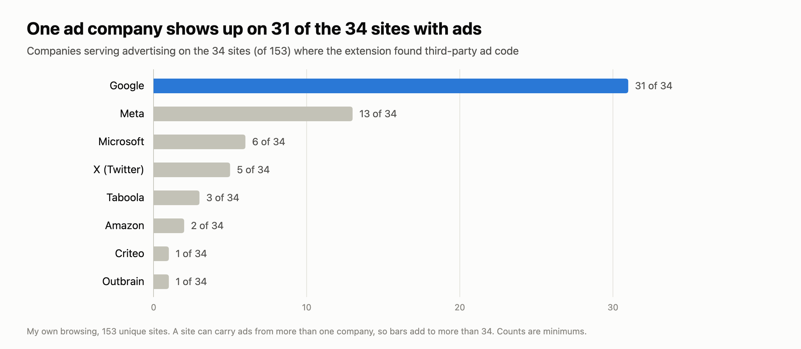
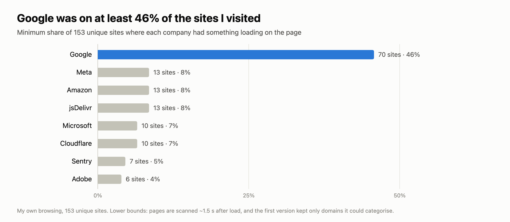

# The uninvited guests on the sites I visit: 12 days of my browsing

Visiting a website feels like a simple exchange: you ask for a page, the site gives it to you. But other companies are in on it too. I call them the uninvited guests.

I started thinking about this when I wrote [The Relocation of Trust](https://dimitra.framer.website/projects/layers-of-digital-trust), about how trust on the internet has moved out of sight, from institutions to code to maths, and got harder for ordinary people to see. I wanted to see it for myself: who is there when I visit a site, who is doing what, and which companies control the market. So I built a Chrome extension, [Who Runs Your Web](https://chromewebstore.google.com/detail/mgpdlopglblbbieoiefelakbhnekpcmk), that lists the companies on each page I visit, grouped by who owns them. This is what 12 days of my own browsing showed.

It's one person's browsing, not a study of the web. The extension shows who was on the page, not what they did.

## One company's ad code was on 31 of the 34 sites with ads

Of the 153 sites I visited, 34 loaded code from an advertising company. Google was behind it on 31 of them. Meta was on 13 and Microsoft on 6. Between them, Google, Meta and Microsoft were on 33 of the 34.

## What that code does

Ad code can recognise your browser from one site to the next. Each visit can be added to a profile of what you read, search for and shop for, and that profile is used to pick the ads you see. That is how targeted advertising is designed to work. My extension can see that the code is there, but it can't see the profile.

Sometimes it goes further. When a page loads, details about you can be offered to many ad companies at once, in an automatic auction for the ad slot. The Irish Council for Civil Liberties estimated in 2022 that this happens hundreds of times a day to a person in the US or Europe. That figure is theirs, it's old, and I haven't measured it myself. See the [ICCL report](https://iccl.ie/news/iccl-report-on-the-scale-of-real-time-bidding-data-broadcasts-in-the-u-s-and-europe).

## Do they sell it?

The big companies say no. Google's [ads page](https://safety.google/privacy/ads-and-data/) says it never sells personal information, including for ads. But it also says it uses the sites you visit to tailor the ads you see. So "we don't sell your data" and "we use where you go to target you" can both be true.

The word "sell" is also slippery. Under California's privacy law, passing data to ad companies for targeted advertising counts as "sharing", which people can opt out of, even when no money changes hands. Some privacy lawyers say it should count as a sale.

I can't tell you what happened to my data. I can tell you who was in a position to see it, and for ads that was mostly Google.

## It isn't only ads

Google was also on at least 46% of my sites overall (70 of 153): analytics on 58, fonts on 29 and ads on 31. Fonts and analytics are not the same as advertising, but it is one company in three roles.

## 7 sites were recording my visit

On 7 sites (about 5%), a tool was recording my visit: where I clicked, how far I scrolled and where the mouse moved, so the site's owner could play it back like a video. Site owners usually do this to find where visitors get stuck. Three companies ran all of these tools: Microsoft, Contentsquare and FullStory, and Microsoft and FullStory both say on their own websites that they don't sell the recordings. But nothing on the page told me, and my browser didn't either.

## What you can do about it

The extension can block these guests if you turn it on. It's off by default, and you can block everyone it knows or pick companies one at a time. It can't stop ads a site shows itself, like YouTube's, or what a site passes on behind the scenes. It cuts down the guests; it doesn't lock the door.

## What these numbers can't tell you

- **Probably too low.** The extension checks each page soon after it opens, so it can miss late arrivals.
- **Just me.** I'm a product designer, and my browsing leans towards tech and security sites. I left out my own work sites.
- **A guest isn't always a spy.** Some, like fonts, are harmless, and I matched them to companies by hand, so some will be wrong.
- **I can't see what they take.** The extension shows who was there, not what they did.

## What leaves your browser

- Your history stays on your device. You can export or delete it any time.
- To check a site's security, the extension sends the site's name (not the page) to a small service I run.
- "Analyse my browsing" sends a summary to an AI service, only when you click it. Anonymous usage counts are on by default and can be switched off. I don't sell data.

## Check your own

Install it, browse as usual for a few days, then open the dashboard. See which company is on most of your sites and what's on the "Needs a look" list. If something surprises you or looks wrong, tell me.

[Install Who Runs Your Web](https://chromewebstore.google.com/detail/mgpdlopglblbbieoiefelakbhnekpcmk) · [Privacy policy](https://dchrysikou.github.io/who-runs-your-web-privacy/PRIVACY.html)
